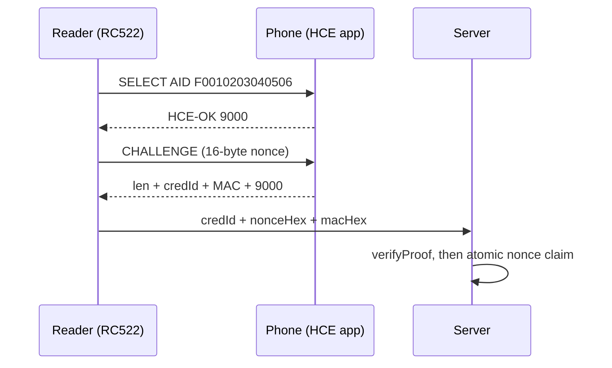
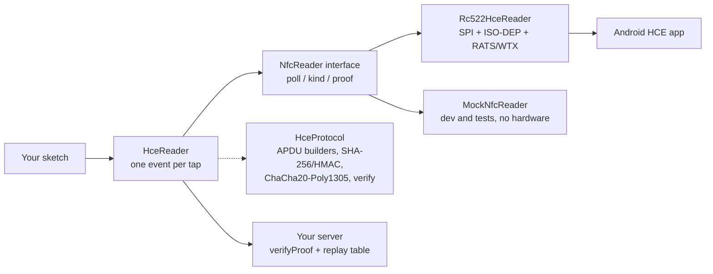

<div align="center">

# RC522-HCE

**Turn an RC522 + Android phone into a credential reader: one `read()` call, no keys on the reader.**

[](https://github.com/NexusDeveloper902/rc522-hce/actions/workflows/CI)
[](LICENSE)


[Quick start](#quick-start) · [Features](#features) · [How it works](#how-it-works) · [Boards](#boards) · [Docs](#docs)

</div>

---

## Features

- **One event per tap.** `reader.read(tap, millis())` hides polling, debounce, re-tap logic, RATS/ATS, S(WTX) handling and FIFO recovery. A resting card never re-fires; a deliberate re-tap does.
- **The phone is a credential, not a UID.** Android randomizes the RF UID per tap, so identity comes from an application exchange instead: `SELECT AID F0010203040506` + random 16-byte `CHALLENGE`, answered with `len + credId + HMAC-SHA256(K_cred, credId || nonce) + 9000`.
- **The reader holds no keys.** It relays its nonce + the phone's MAC; your server verifies with that credential's key (`HceReader::verifyProof()`), then claims the nonce atomically. Enrollment seals the phone's key with ChaCha20-Poly1305 under your per-device reader secret — never raw, never logged.
- **Testable without hardware.** `MockNfcReader` implements the same transport interface as the radio; the protocol core is pure C++ with 109 host-side tests, libFuzzer targets, sanitizer/coverage gates, and a pinned interop vector.
- **No source edits, ever.** Pins, timings and AID come from build flags, board presets, or runtime calls.
- **Honest about what it can't do.** A valid MAC is not proximity proof (relays are out of scope), MIFARE UIDs are clonable compatibility ids, and the server's key database is the trust root. See [`docs/SECURITY.md`](docs/SECURITY.md).

> [!NOTE]
> Protocol v2 (16-byte nonces, AEAD enrollment) is the current wire format. Migrating a v1 deployment? See [`docs/MIGRATION.md`](docs/MIGRATION.md).

## Quick start

### Prerequisites

| Requirement | Why |
|---|---|
| PlatformIO (or Arduino IDE) + an ESP32 / AVR / STM32 / RP2040 board | the firmware target |
| RC522 module wired per [`docs/WIRING.md`](docs/WIRING.md) | the radio |
| `miguelbalboa/MFRC522@^1.4.11` | the underlying SPI driver |
| `mike-matera/ArduinoSTL@^1.3.3` | `std::string` shim, 8-bit AVR only |

### Install

```ini
; platformio.ini
lib_deps =
    geek02/RC522-HCE@^2.0.0
    miguelbalboa/MFRC522@^1.4.11
```

with `-DMFRC522_SPICLOCK=1000000u` in `build_flags` (1 MHz SPI is the bench-proven setting over Dupont jumpers).

Arduino IDE: Sketch → Include Library → Add `.ZIP Library` from a [release](https://github.com/NexusDeveloper902/rc522-hce/releases) zip (plus the `MFRC522` library, ≥ 1.4.11).

### Read taps in 30 seconds

```cpp
#include <HceReader.h>
#include <Rc522HceReader.h>

#ifdef ESP32
rc522hce::Rc522HceReader radio;                    // DevKit VSPI defaults
#else
rc522hce::Rc522HceReader radio(10, 9, 13, 12, 11); // UNO/Nano hardware SPI
                                                   // (Mega: 53, 5, 52, 50, 51)
#endif
rc522hce::HceReader reader(radio);                 // configure once…

void setup() {
    Serial.begin(115200);
    if (!reader.begin()) {
        Serial.println("RC522 not responding — check wiring + 3.3 V");
    }
}

void loop() {
    rc522hce::HceReader::Tap tap;
    if (reader.read(tap, millis())) {              // …then just read (identified, not yet authenticated)
        if (tap.isHce) {
            // POST tap.credentialId + tap.proof.nonceHex + tap.proof.macHex
            // to your server; it verifies + checks replay before authorizing.
        } else {
            // physical card: tap.credentialId is the uppercase hex UID (compatibility id, clonable).
        }
    }
}
```

Pairing a new phone is one call — normal taps never ask the phone for its key:

```cpp
reader.setEnrollment(true, readerSecret);   // enrollment mode on
// …taps now also fetch + wrap the phone's key into tap.proof…
reader.setEnrollment(false);                // back to normal
```

> [!IMPORTANT]
> A phone must sit **2–3 cm above the sensor**, flat and steady until the tap registers (~half a second — an HCE tap is a whole conversation, not a card blip). Too far, pressed flat against the reader, or lifted early are the three most common "it doesn't read" causes.

> [!TIP]
> No hardware? `rc522hce::MockNfcReader` implements the same `NfcReader` interface — wrap it in `HceReader` exactly like the radio and develop against `pushTap("...")`.

## How it works

A tap is a three-party exchange. The reader challenges, the phone proves, the server decides:





Three separate decisions — validity (crypto), freshness (backend nonce table), authorization (your app). `verifyProof() == true` is only the first:

```cpp
// credKey = the stored 32-byte key for tap.credentialId
if (!rc522hce::HceReader::verifyProof(tap.proof, tap.credentialId, credKey)) {
    // reject — wrong key, tampered MAC, or impossible transcript.
    // (Freshness/single-use is a separate atomic backend step — see docs/SECURITY.md.)
}
```

| Path | What lives there |
|---|---|
| [`src/HceReader.h`](src/HceReader.h) | THE public API: configure once, then just `read()` (transport + debounce, pure C++) |
| [`src/HceProtocol.h`](src/HceProtocol.h) / [`.cpp`](src/HceProtocol.cpp) | APDU builders/parsers, SHA-256/HMAC, key-wrap/unwrap, versions, ISO-DEP helpers (host-testable) |
| [`src/NfcReader.h`](src/NfcReader.h) | Transport interface + `CredentialKind` + `HceProof` relay struct |
| [`src/Rc522HceReader.h`](src/Rc522HceReader.h) | Radio driver (MFRC522 over SPI) — device only |
| [`src/Rc522HceConfig.h`](src/Rc522HceConfig.h) | Pins/timings/AID via build flags, board presets auto-detected |
| [`src/CardDebouncer.h`](src/CardDebouncer.h) | Re-read suppression, pure C++ |
| [`src/MockNfcReader.h`](src/MockNfcReader.h) | Hardware-free transport for dev/tests |
| [`src/TsLog.h`](src/TsLog.h) | Timestamped `Print` decorator (diagnostics sink) |
| [`src/CompatNames.h`](src/CompatNames.h) | Optional legacy-name aliases for adoption (included by nothing) |
| [`extras/reference-backend/`](extras/reference-backend/) | Zero-dependency Python server: verify + atomic replay table + enrollment |

Need the lower layers directly? `radio.poll(id)` + `radio.kind()` / `radio.lastProof()` and `CardDebouncer` are all public. Everything a phone app, reader firmware, or backend needs is reachable from the single header `HceReader.h` — full symbol reference: [`docs/API.md`](docs/API.md).

### Where the HCE key lives

- `K_cred` is **per credential**, generated and stored by the phone (Android Keystore). Neither the reader nor this library ever holds or transmits it raw.
- At enrollment, the phone releases `K_cred` **once**, inside a window its holder opens; the reader seals it with ChaCha20-Poly1305 under the `readerSecret` you passed to `setEnrollment()` and wipes the copy. Unwrap it server-side with `unwrapKeyHex()` (tag failure means wrong secret or tampering — reject).
- Every tap afterwards: the reader relays `credId + nonce + mac` and your server calls `HceReader::verifyProof(proof, credId, credKey)` for cryptographic validity, then claims the nonce atomically (replay table) before authorizing.

<details>
<summary><b>Custom timing, RNG, and the no-source-edits rule</b></summary>

Timings that need to change per loop iteration stay in code:

```cpp
rc522hce::Rc522HceOptions opts;
opts.reinitIntervalMs = 5000;  // PCD retry + runtime probe cadence
opts.hceSettleMs = 400;        // park-and-activate radio-silence window
rc522hce::Rc522HceReader reader(/*ss=*/13, /*rst=*/255 /*3V3-strapped*/,
                                /*sck=*/14, /*miso=*/2, /*mosi=*/15,
                                &Serial, opts);
```

Randomness per board: ESP32 uses the hardware RNG (`esp_random`) automatically. Other chips default to a best-effort hobby-grade fallback that is NOT approved for production credentials — inject an approved source (see `docs/SECURITY.md` "Randomness policy"):

```cpp
uint32_t myNoise() { /* floating analog pin, radio RSSI, TRNG chip… */ return ...; }
rc522hce::Rc522HceReader reader(10, 9, 13, 12, 11, &Serial,
                                rc522hce::Rc522HceOptions(), myNoise);
```

Every knob in `src/Rc522HceConfig.h` is `#ifndef`-guarded: build flag → board preset → default. `Rc522HceReader radio;` is correctly wired with no args, and the AID can additionally change at runtime (`setAid`, 1..11 bytes). The protocol, framing, debounce and retry logic is chip-independent pure C++; host compilation does not imply identical behavior on every MCU/compiler — validate on the target toolchains.

</details>

## Boards

| Board | Validation | Notes |
|---|---|---|
| ESP32 DevKit (VSPI) | Bench-validated: HCE taps + MIFARE | The reference target; `esp_random` approved RNG |
| ESP32-CAM | Compiles (CI rewire job), same silicon | Custom pins via build flags; camera + reader share 3V3 budget |
| Mega 2560 | Compiles (CI); app fits (32% RAM) | Use Mega over UNO for real HCE use |
| UNO/Nano (ATmega328P) | Compiles; **RAM overflow** with full HCE app | Needs ArduinoSTL shim; Mega or 32-bit for real use |
| ESP8266 / RP2040 / STM32 | Board presets + constructor wiring only | Not bench-validated — please report results |

<details>
<summary><b>Measured firmware sizes</b></summary>

Release builds, `BasicTap` / `HceEnroll`:

| Example | ESP32 flash | ESP32 RAM | Mega flash | Mega RAM |
|---|---|---|---|---|
| BasicTap | 306 KB (23%) | 21.9 KB (6.7%) | 36.1 KB (14.2%) | 2629 B (32.1%) |
| HceEnroll | 306 KB (23%) | 21.9 KB (6.7%) | 36.3 KB (14.3%) | 2651 B (32.4%) |

HCE tap latency is roughly half a second of radio contact (RATS/ATS, SELECT, CHALLENGE, S(WTX) rounds) — hold the phone steady until the tap registers.

</details>

## Phone-app contract

Your Android HCE app must implement `docs/HCE_PROTOCOL.md`:

- AID `F0010203040506`, `SELECT` → `HCE-OK 9000` (else `6A82`);
- `CHALLENGE` (`80 10 00 00 10 + nonce`) → `len + credId + MAC + 9000`,
  with `MAC = HMAC-SHA256(K_cred, credId || nonce)`;
- `ENROLL` (`80 20 00 00 20`) → `K_cred + 9000`, only inside the holder-opened
  enrollment window (else `6985`); no key yet → `6A88` on `CHALLENGE`.

Shared test vector (pinned in `test/` — verify your app against it before touching hardware):

| item | value |
|---|---|
| `K_cred` | `000102…1f` |
| `credId` | `PLS-K3Y7V3CT0R5Z` |
| `nonce` | `000102…0f` (16 bytes) |
| `MAC` | `70f32d7b458139d8f5f522a7314c31205eca50619a5d26dc466d7d5b60aab154` |

## Tests

```bash
pio test -e native       # 109 tests, no board needed
pio test -e native-san   # same suite under ASan + UBSan
pio test -e native-cov   # same suite with coverage (gate: 90% lines on src/)
```

<details>
<summary><b>What the suites cover</b></summary>

- **APDU wire contract:** byte-exact builders, every parser shape.
- **Crypto trust contract:** RFC 4231 + FIPS vectors, tamper properties, key-wrap/unwrap, RNG seam, RFC 8439 ChaCha20-Poly1305 vectors.
- **ISO-DEP RF contract:** SAK, PCB classes, I-block stripping, block resync.
- **Debounce rules**, **transport contract** incl. simulated end-to-end HCE taps, **facade contract** (one `read()` per physical tap, typed kind, proof forwarding, enrollment, health), and the **exposed protocol surface** — that test file includes only `HceReader.h`, so the docs cannot promise something the API stops exposing.
- **Beyond unit tests:** `fuzz/` hammers every wire parser under libFuzzer + ASan (CI, 60 s per target); `test/test_hil_radio.cpp` runs on-device (`pio test -e esp32test` with a wired RC522 — RF assertions ignore gracefully when unwired); the Python reference backend has its own suite (`python3 -m unittest test_hce_backend -v` in `extras/reference-backend/`).

</details>

## Docs

| Topic | Where |
|---|---|
| Symbols, signatures, return codes, troubleshooting | [`docs/API.md`](docs/API.md) |
| Byte-level wire spec, status words, test vector | [`docs/HCE_PROTOCOL.md`](docs/HCE_PROTOCOL.md) |
| Threat model, replay, enrollment, RNG, known limits | [`docs/SECURITY.md`](docs/SECURITY.md) |
| Pins, power, tap distance, symptoms and fixes | [`docs/WIRING.md`](docs/WIRING.md) |
| Breaking changes (v1→v2) per side | [`docs/MIGRATION.md`](docs/MIGRATION.md) |
| What changed in each release | [`CHANGELOG.md`](CHANGELOG.md) |
| Contributing, commit format, release process | [`CONTRIBUTING.md`](CONTRIBUTING.md) |

## License

[Apache-2.0](LICENSE)
