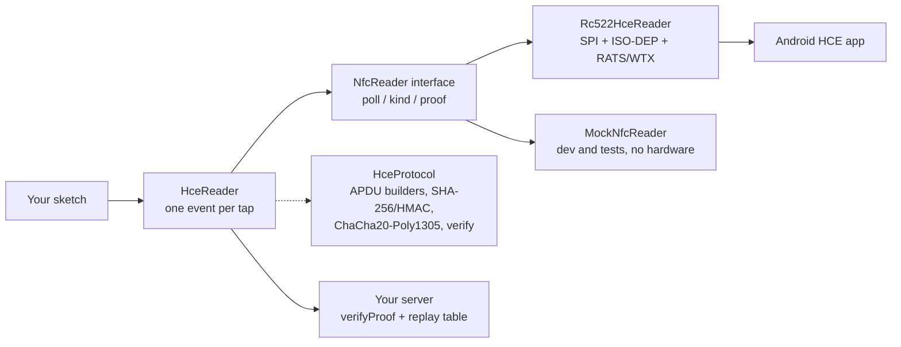
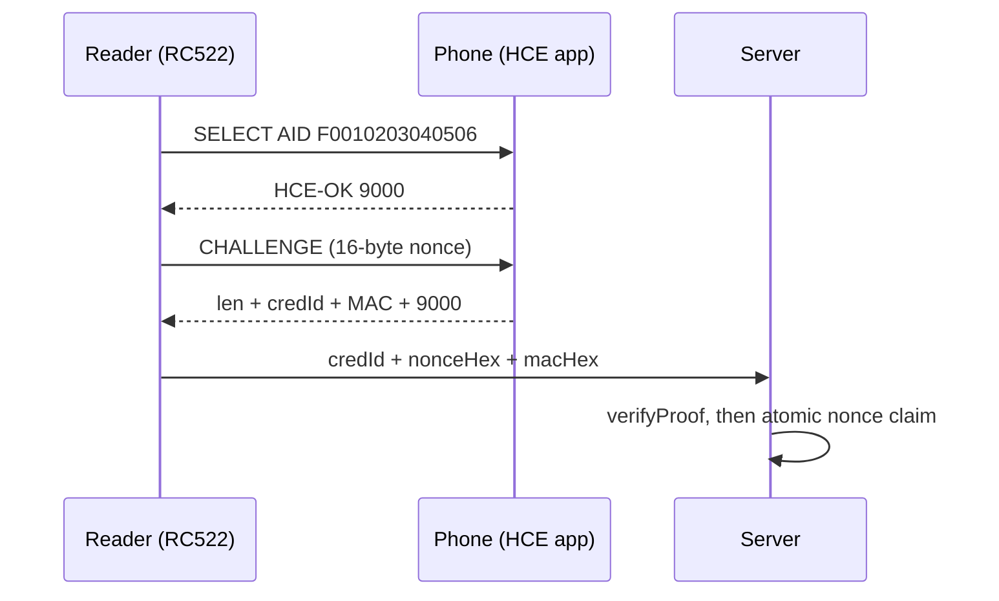

# RC522-HCE

[](https://github.com/NexusDeveloper902/rc522-hce/actions/workflows/CI)
[](https://github.com/NexusDeveloper902/rc522-hce/releases)
[](LICENSE)

Turn an RC522 + Android phone into a credential reader. One `read()` call
returns MIFARE card UIDs **and** authenticated phone identities — on any
Arduino-compatible microcontroller (ESP32, ESP8266, AVR, STM32, RP2040,
nRF52, Teensy: anything with an Arduino core and SPI).

- 📦 Install: `geek02/RC522-HCE@^2.0.0` on the
  [PlatformIO registry](https://registry.platformio.org/libraries/geek02/RC522-HCE)
- 📖 Full reference: [`docs/API.md`](docs/API.md) · Threat model: [`docs/SECURITY.md`](docs/SECURITY.md)

## Contents

- [Why this library](#why-this-library)
- [How it works](#how-it-works)
- [Install](#install)
- [Quick start](#quick-start)
- [Configuration](#configuration)
- [Boards](#boards)
- [Phone-app contract](#phone-app-contract)
- [API at a glance](#api-at-a-glance)
- [Tests](#tests)
- [Docs](#docs)
- [Contributing](#contributing)
- [License](#license)

## Why this library

- **One event per tap.** `reader.read(tap, millis())` hides polling,
  debounce, re-tap logic, RATS/ATS, WTX, and FIFO recovery. A resting
  card never re-fires; a deliberate re-tap does.
- **The phone is a credential, not a UID.** Android randomizes the RF
  UID per tap, so identity comes from an application exchange instead:
  `SELECT AID F0010203040506` + random 16-byte `CHALLENGE`, answered with
  `len + credId + HMAC-SHA256(K_cred, credId || nonce) + 9000`.
- **The reader holds no keys.** It relays its nonce + the phone's MAC;
  your server verifies with that credential's key
  (`HceReader::verifyProof()`), then claims the nonce atomically.
  Enrollment seals the phone's key with ChaCha20-Poly1305 under your
  per-device reader secret — never raw, never logged.
- **Testable without hardware.** `MockNfcReader` implements the same
  transport interface as the radio; the protocol core is pure C++ with
  109 host-side tests, fuzz targets, sanitizer/coverage gates, and a
  pinned interop vector.
- **No source edits, ever.** Pins, timings, and AID come from build
  flags, board presets, or runtime calls.

## How it works



A tap is a three-party exchange. The reader challenges, the phone proves,
the server decides:



Three separate decisions — validity (crypto), freshness (backend nonce
table), authorization (your app). `verifyProof() == true` is only the
first. Full contract: [`docs/SECURITY.md`](docs/SECURITY.md).

## Install

**PlatformIO** — add to `platformio.ini`:

```ini
lib_deps =
    geek02/RC522-HCE@^2.0.0
    miguelbalboa/MFRC522@^1.4.11
```

with `-DMFRC522_SPICLOCK=1000000u` in `build_flags` (1 MHz SPI is the
bench-proven setting over Dupont jumpers; see `docs/WIRING.md`).

> **8-bit AVR boards (UNO, Nano, Mega):** the AVR toolchain ships no C++
> standard library, so add one more dependency for `std::string`:
>
> ```ini
> lib_deps =
>     geek02/RC522-HCE@^2.0.0
>     miguelbalboa/MFRC522@^1.4.11
>     mike-matera/ArduinoSTL@^1.3.3   # 8-bit AVR only
> ```
>
> (Arduino IDE: install `ArduinoSTL` from the Library Manager.)
> 32-bit boards (ESP32, ESP8266, RP2040, STM32, nRF, Teensy) need no shim.
> Note: ATmega328P (UNO/Nano, 2 KB RAM) compiles but its static RAM
> overflows with the full HCE app — use a Mega (verified: 32% RAM) or any
> 32-bit board for real use.

**Arduino IDE** — Sketch → Include Library → Add `.ZIP Library` from a
[release](https://github.com/NexusDeveloper902/rc522-hce/releases) zip.
Requires the `MFRC522` library (≥ 1.4.11).

## Quick start

```cpp
#include <HceReader.h>
#include <Rc522HceReader.h>

#ifdef ESP32
rc522hce::Rc522HceReader radio;                    // DevKit VSPI defaults
#else
rc522hce::Rc522HceReader radio(10, 9, 13, 12, 11); // UNO/Nano hardware SPI
                                                   // (Mega: 53, 5, 52, 50, 51)
#endif
rc522hce::HceReader reader(radio);                 // configure once…

void setup() {
    Serial.begin(115200);
    if (!reader.begin()) {
        Serial.println("RC522 not responding — check wiring + 3.3 V");
    }
}

void loop() {
    rc522hce::HceReader::Tap tap;
    if (reader.read(tap, millis())) {              // …then just read (identified, not yet authenticated)
        if (tap.isHce) {
            // POST tap.credentialId + tap.proof.nonceHex + tap.proof.macHex
            // to your server; it verifies + checks replay before authorizing.
        } else {
            // physical card: tap.credentialId is the uppercase hex UID (compatibility id, clonable).
        }
    }
}
```

Enrollment (pairing a new phone) is one call — normal taps never ask the
phone for its key:

```cpp
reader.setEnrollment(true, readerSecret);   // enrollment mode on
// …taps now also fetch + wrap the phone's key into tap.proof…
reader.setEnrollment(false);                // back to normal
```

Verifying a relayed tap on your server, with the API exposed here — the only
place the credential key exists outside the phone:

```cpp
// credKey = the stored 32-byte key for tap.credentialId
if (!rc522hce::HceReader::verifyProof(tap.proof, tap.credentialId, credKey)) {
    // reject — wrong key, tampered MAC, or impossible transcript.
    // (Freshness/single-use is a separate atomic backend step — see docs/SECURITY.md.)
}
```

Need the lower layers directly? `radio.poll(id)` + `radio.kind()` /
`radio.lastProof()`, `CardDebouncer`, and `MockNfcReader` (same interface,
`pushTap("...")` then `poll()` — for dev without hardware) are all public.

> **Tap distance:** a phone must sit **2–3 cm above the sensor**, flat and
> steady until the tap registers (~half a second — an HCE tap is a whole
> conversation, not a card blip). Too far, pressed flat against the reader,
> or lifted early are the three most common "it doesn't read" causes. See
> `docs/WIRING.md`.

Custom timing:

```cpp
rc522hce::Rc522HceOptions opts;
opts.reinitIntervalMs = 5000;  // PCD retry + runtime probe cadence
opts.hceSettleMs = 400;        // park-and-activate radio-silence window
rc522hce::Rc522HceReader reader(/*ss=*/13, /*rst=*/255 /*3V3-strapped*/,
                                /*sck=*/14, /*miso=*/2, /*mosi=*/15,
                                &Serial, opts);
```

Randomness per board: on ESP32 the driver uses the hardware RNG
(`esp_random`) automatically. Other chips default to a best-effort
hobby-grade fallback that is NOT approved for production credentials —
production firmware on RNG-less chips MUST inject an approved source
(see `docs/SECURITY.md` "Randomness policy"):

```cpp
uint32_t myNoise() { /* floating analog pin, radio RSSI, TRNG chip… */ return ...; }
rc522hce::Rc522HceReader reader(10, 9, 13, 12, 11, &Serial,
                                rc522hce::Rc522HceOptions(), myNoise);
```

The protocol, framing, debounce and retry logic is chip-independent pure C++;
only pins and the RNG source vary by board. Host compilation does not imply
identical behavior on every MCU/compiler — validate on the target toolchains
before release.

Without hardware (dev/tests): `rc522hce::MockNfcReader` implements the same
`NfcReader` interface — wrap it in `HceReader` exactly like the radio.

## Configuration

Build flags, not source edits. Nothing about the wiring, timings or AID
requires editing the library. Every knob in `src/Rc522HceConfig.h` is
`#ifndef`-guarded, so a build flag always wins, board presets cover the
common boards when you do not override, and defaults apply otherwise:

```ini
; platformio.ini
build_flags =
    -DRC522HCE_SS_PIN=13       ; your RC522 SDA/SS
    -DRC522HCE_RST_PIN=255     ; 255 = RST strapped to 3V3 (no pin driven)
    -DRC522HCE_SCK_PIN=14
    -DRC522HCE_MISO_PIN=2
    -DRC522HCE_MOSI_PIN=15
    -DRC522HCE_DEBOUNCE_MS=1500
    -DMFRC522_SPICLOCK=1000000u
```

Auto-detected when you do not override: **ESP32** (DevKit VSPI), **AVR** (Mega SS 53 /
UNO-Nano SS 10 — SCK/MISO/MOSI are fixed hardware SPI there), **ESP8266** (NodeMCU),
**RP2040** (Pico), **STM32** (SPI1). Opt out entirely with `-DRC522HCE_NO_BOARD_PRESET`.
Resolution order is build flag → board preset → default, and it applies to
default-constructed readers too, so `Rc522HceReader radio;` is always correctly wired —
no silent wrong-pin trap.

| Knob | Build flag | Default |
|---|---|---|
| SS / RST / SCK / MISO / MOSI | `RC522HCE_{SS,RST,SCK,MISO,MOSI}_PIN` | preset or DevKit pins |
| AID the phone app must serve | `RC522HCE_AID_BYTES=0xF0,…` | `F0010203040506` |
| Re-read suppression window | `RC522HCE_DEBOUNCE_MS` | 2000 |
| PCD retry / health-probe cadence | `RC522HCE_REINIT_INTERVAL_MS` | 5000 |
| Park-and-activate settle window | `RC522HCE_HCE_SETTLE_MS` | 400 |
| SPI clock (read by the MFRC522 lib) | `MFRC522_SPICLOCK` | 1000000 (1 MHz) |

The AID is special: it is the contract between your reader and your phone app, so it can
be changed **at runtime** with no reflash and no source edit:

```cpp
const uint8_t myAid[] = {0xD1, 0x76, 0x00, 0x00, 0x85};
if (!reader.setAid(myAid, sizeof(myAid))) { /* rejected — 1..11 bytes */ }
// reader.selectedAid() / selectedAidLen() reports what a phone must serve
```

Timings that need to change per loop iteration (rather than per build) stay in code:

```cpp
rc522hce::Rc522HceOptions opts;
opts.reinitIntervalMs = 5000;   // PCD retry + runtime probe cadence
opts.hceSettleMs = 400;         // park-and-activate radio-silence window
rc522hce::Rc522HceReader radio(/*ss=*/13, /*rst=*/255 /*3V3-strapped*/,
                               /*sck=*/14, /*miso=*/2, /*mosi=*/15,
                               &Serial, opts);
```

Adopting into an existing codebase? If your project already uses the historical API names
(`Presence::Rc522NfcReader`, `Presence::Hce::buildSelectAid`, `Presence::HceProof`,
`Presence::Signer::toHex`), include the optional alias layer and existing call sites keep
compiling — the aliases are the *same types*, so values cross the seam both ways:

```cpp
#include <CompatNames.h>   // optional, migration only; not a dependency of anything
```

It is deliberately included by no other header, so it can never become a hidden
dependency, and its Arduino-only aliases are guarded so it also compiles in host tests.

## Boards

| Board | Validation | Notes |
|---|---|---|
| ESP32 DevKit (VSPI) | Bench-validated: HCE taps + MIFARE | The reference target; `esp_random` approved RNG |
| ESP32-CAM | Compiles (CI rewire job), same silicon | Custom pins via build flags; camera + reader share 3V3 budget |
| Mega 2560 | Compiles (CI); app fits (32% RAM) | Verified numbers below; use Mega over UNO for real HCE use |
| UNO/Nano (ATmega328P) | Compiles; **RAM overflow** with full HCE app | Needs ArduinoSTL shim; Mega or 32-bit for real use |
| ESP8266 / RP2040 / STM32 | Board presets + constructor wiring only | Not bench-validated — please report results |

Measured firmware sizes (release builds, `BasicTap` / `HceEnroll`):

| Example | ESP32 flash | ESP32 RAM | Mega flash | Mega RAM |
|---|---|---|---|---|
| BasicTap | 306 KB (23%) | 21.9 KB (6.7%) | 36.1 KB (14.2%) | 2629 B (32.1%) |
| HceEnroll | 306 KB (23%) | 21.9 KB (6.7%) | 36.3 KB (14.3%) | 2651 B (32.4%) |

HCE tap latency is roughly half a second of radio contact (RATS/ATS,
SELECT, CHALLENGE, S(WTX) rounds) — hold the phone steady until the tap
registers; see `docs/WIRING.md`.

## Phone-app contract

Your Android HCE app must implement `docs/HCE_PROTOCOL.md`:

- AID `F0010203040506`, `SELECT` → `HCE-OK 9000` (else `6A82`);
- `CHALLENGE` (`80 10 00 00 10 + nonce`) → `len + credId + MAC + 9000`,
  with `MAC = HMAC-SHA256(K_cred, credId || nonce)`;
- `ENROLL` (`80 20 00 00 20`) → `K_cred + 9000`, only inside the holder-opened
  enrollment window (else `6985`); no key yet → `6A88` on `CHALLENGE`.

Shared test vector (pinned in `test/` — verify your app against it):

| item | value |
|---|---|
| `K_cred` | `000102…1f` |
| `credId` | `PLS-K3Y7V3CT0R5Z` |
| `nonce` | `000102…0f` (16 bytes) |
| `MAC` | `70f32d7b458139d8f5f522a7314c31205eca50619a5d26dc466d7d5b60aab154` |

## API at a glance

> Full reference with signatures, byte layouts, return codes, backend
> snippets and troubleshooting: [`docs/API.md`](docs/API.md).

Everything a phone app, reader firmware, or backend needs — all reachable from the single
header `HceReader.h`:

| Call | What it is |
|---|---|
| `HceReader reader(transport)` / `reader.begin()` / `reader.read(tap, millis())` | the whole reader app: one event per physical tap |
| `tap.credentialId` | the credential: MIFARE hex UID, or the HCE application id |
| `tap.isHce`, `tap.kind`, `tap.proof.nonceHex`, `tap.proof.macHex` | how it was identified (typed kind + `isHce` convenience) + the UNVERIFIED transcript to relay; server acceptance is a separate step |
| `tap.proof.keyWrappedHex`, `tap.proof.keyNonceHex` | enrollment taps only: the phone's key, sealed (ChaCha20-Poly1305 — see `docs/SECURITY.md`) |
| `reader.setEnrollment(on, readerSecret)` | turn enrollment mode on; the only secret the reader holds (high-entropy, per-device — see `docs/SECURITY.md`) |
| `reader.setAid(bytes, len)`, `selectedAid()`, `selectedAidLen()` | change the AID at runtime; report what a phone must serve |
| `HceReader::verifyProof(proof, credId, credKey)` | **backend**: cryptographic validity of a relayed tap, constant-time (freshness + authorization are separate — see `docs/SECURITY.md`) |
| `HceReader::aid()`, `aidLen()` | the AID the phone's HCE app must serve (`F0010203040506`) |
| `HceReader::nonceLen()`, `macLen()`, `keyLen()`, `maxCredentialLen()` | protocol lengths (16 / 32 / 32 / 32) |
| `HceReader::statusWordName(sw1, sw2)` | `9000`, `6A82`, `6A88`, `6985`, `6700`, `6D00`, `6E00` — for operator-facing messages |
| `HceReader::toHex()`, `HceReader::fromHex()` | wire transcripts and wrapped keys are hex |
| `HceReader::selfCheckVector()` | true when the shared interop vector verifies |
| `TestVector::*` | the pinned vector: credId, key, nonce, MAC, reader secret, wrapped key |
| `buildSelectAid()`, `buildSelectAidWith()`, `buildChallenge()`, `buildEnroll()` | the exact APDU bytes (for custom transports) |
| `parseSelectResponse()`, `parseChallengeResponse()`, `isKeyMissing()` | response classification |
| `hmacSha256()`, `sha256Bytes()`, `wrapKeyHex()` | the crypto, dependency-free (`unwrapKeyHex()` is the server-side mirror) |
| `MockNfcReader`, `CardDebouncer` | hardware-free development, and the 1-tap rule |

### Where the HCE key lives

- `K_cred` is **per credential**, generated and stored by the phone (Android Keystore).
  Neither the reader nor this library ever holds or transmits it raw.
- At enrollment, the phone releases `K_cred` **once**, inside a window its holder opens;
  the reader seals it with ChaCha20-Poly1305 under the `readerSecret` you passed to
  `setEnrollment()` and wipes the copy. Unwrap it server-side with `unwrapKeyHex()`
  (tag failure means wrong secret or tampering — reject).
- Every tap afterwards: the reader relays `credId + nonce + mac` and your server calls
  `HceReader::verifyProof(proof, credId, credKey)` for cryptographic validity, then
  claims the nonce atomically (replay table) before authorizing — false means reject.
  Full contract: [`docs/SECURITY.md`](docs/SECURITY.md).

Verify a new phone app or backend against the pinned vector first
(`pio test -e native` also runs it):

| item | value |
|---|---|
| `K_cred` | `000102…1f` |
| `credId` | `PLS-K3Y7V3CT0R5Z` |
| `nonce` | `000102…0f` (16 bytes) |
| `MAC` | `70f32d7b458139d8f5f522a7314c31205eca50619a5d26dc466d7d5b60aab154` |

## Tests

```sh
pio test -e native       # 109 tests, no board needed
pio test -e native-san   # same suite under ASan + UBSan
pio test -e native-cov   # same suite with coverage (gate: 90% lines on src/)
```

The native run covers seven suites: APDU wire contract (byte-exact builders, every parser shape),
crypto trust contract (RFC 4231 + FIPS vectors + tamper properties +
key-wrap/unwrap + RNG seam + RFC 8439 ChaCha20-Poly1305 vectors), ISO-DEP RF contract (SAK, PCB classes, I-block
stripping, block resync), debounce rules, the transport contract incl.
simulated end-to-end HCE taps, the facade contract (one read() per
physical tap, typed kind incl. legacy-string fallback, proof forwarding,
enrollment, health), and the exposed protocol surface (versions, kind,
replay-is-server-side, unwrap) — that test file includes only `HceReader.h`,
so the docs cannot promise something the API stops exposing.

Beyond unit tests: `fuzz/` hammers every wire parser under libFuzzer +
ASan (CI, 60 s per target), and `test/test_hil_radio.cpp` runs on-device
(`pio test -e esp32test` with a wired RC522 — vector, RNG, and live
radio probe; RF assertions ignore gracefully when unwired). The Python
reference backend has its own suite (`extras/reference-backend`,
`python3 -m unittest test_hce_backend -v`).

## Docs

| Document | What it answers |
|---|---|
| [`docs/API.md`](docs/API.md) | Symbols, signatures, return codes, backend snippets, troubleshooting |
| [`docs/HCE_PROTOCOL.md`](docs/HCE_PROTOCOL.md) | Byte-level wire spec, status words, test vector |
| [`docs/SECURITY.md`](docs/SECURITY.md) | Threat model, replay, enrollment, RNG, known limits |
| [`docs/WIRING.md`](docs/WIRING.md) | Pins, power, tap distance, symptoms and fixes |
| [`docs/MIGRATION.md`](docs/MIGRATION.md) | Breaking changes (v1→v2) per side |
| [`CHANGELOG.md`](CHANGELOG.md) | What changed in each release |
| [`extras/reference-backend/`](extras/reference-backend/) | Tested zero-dependency Python server |

## Contributing

Bug reports and pull requests welcome — please read
[`CONTRIBUTING.md`](CONTRIBUTING.md) first (conventional commits, PR
checklist, and the rule that wire/protocol changes need a versioned
migration). Security issues go through the private channels in
[`SECURITY.md`](SECURITY.md), never public issues.

## License

Apache License 2.0 — see [LICENSE](LICENSE). Commercial and private use,
modification and distribution allowed; contributions welcome via pull request.
